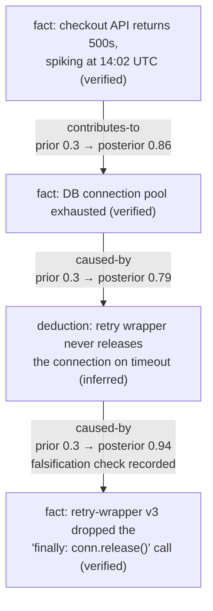
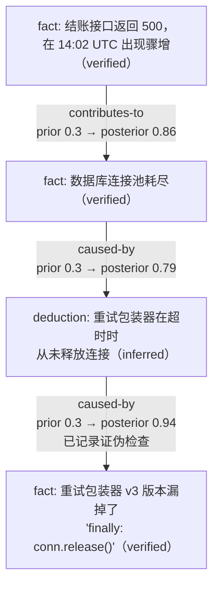

# Causal Graph Agent Harness

**Status: prototype, still under active development.** Interfaces, storage
format, and process may change.

This repository ships two complementary agent skills: `causal-graph-research`
helps an agent investigate without locking onto an early explanation, while
`aha-opportunity-scout` helps it notice one useful, evidence-based next move
after the immediate task is complete.

[English](#english) | [中文](#中文)

---

## English

### Why

LLM agents investigating a question tend to lock onto an early verdict and
then only look for evidence that confirms it — instead of checking whether
multiple factors are jointly responsible, or whether a deeper root cause
exists behind the first plausible explanation. Research this project is
built on ([`docs/research-motivation.md`](docs/research-motivation.md))
found that this bias lives in *what evidence an agent chooses to look for*,
not in how it weighs evidence once found.

So instead of trusting one unstructured reasoning chain, this harness makes
an agent externalize its investigation as an explicit graph: facts, the
deductions built on them, and a probabilistic causal graph between them —
with a required falsification check before any causal claim is allowed to
become high-confidence. Full rationale in
[`docs/superpowers/specs/2026-08-01-causal-graph-agent-harness-design.md`](docs/superpowers/specs/2026-08-01-causal-graph-agent-harness-design.md).

### What it is

- **Lightweight** — plain JSON/JSONL files + a handful of CLI scripts. No
  server, no database, no agent SDK.
- **Deterministic** — all graph mutation and Bayesian arithmetic is owned by
  Python scripts, not LLM output, so the graph stays trustworthy regardless
  of which model drove the investigation.
- **Portable across agents** — works with any coding agent that can read a
  repo and run shell commands. [`AGENTS.md`](AGENTS.md) is the agent-neutral
  entrance point; Claude Code additionally auto-discovers it as a skill.
- **Optional pipeline** — a simple question can stop at one or two facts.
  The full fact → deduction → causal-edge → Bayesian-update flow is there
  for when a question actually needs it, not forced on every use.
- **Opportunity-aware** — the companion `aha-opportunity-scout` skill can
  point a beginner toward a concrete contribution, community question,
  documentation/test improvement, or reusable next step when the task gives
  enough evidence. It stays optional and does not perform outreach for the
  user.

### The two skills

Use [`causal-graph-research`](skills/causal-graph-research/SKILL.md) when an
investigation could suffer from premature closure, confirmation bias, or a
missing causal chain. Use
[`aha-opportunity-scout`](skills/aha-opportunity-scout/SKILL.md) after a
technical, research, or repository task when an adjacent next move may help.
They compose naturally: the causal graph keeps the investigation honest, and
the opportunity scout turns what was learned into a practical next action.

### Example: a layered root cause

A single fact rarely explains an incident by itself. The harness's payoff shows
up when the graph has to descend several layers before it reaches something
worth actually fixing:



- `F2` (pool exhaustion) is the *obvious*, easy-to-stop-at explanation — an
  unstructured investigation would likely report it and move on.
- The graph keeps asking "why" instead: each arrow is a
  `propose-causal-edge` / `update-causal-edge` pair, and its posterior has to
  be earned from actual evidence, not from how plausible the story sounds.
- The last edge (`D1 → F3`) could not cross the high-confidence threshold
  until `record-falsification-check` ruled out an alternative explanation (a
  plain traffic spike) — the falsification gate described above, which is
  what pushes the investigation past the second layer instead of settling
  for "pool exhaustion" as the final answer.

The actual root cause — a dropped `finally` block introduced three layers
back by a dependency upgrade — is exactly what an agent that locks onto the
first plausible explanation would never reach.

### Quick start

```bash
pip install -e .
causal-graph add-fact --topic my-topic --statement "..." \
  --evidence-id <id> --confidence verified
```

That's a complete, legitimate use on its own. For the full process — evidence
adapters, proposing deductions and causal edges, Bayesian updates, the
falsification-gate retry pattern, and the review queue — read
[`AGENTS.md`](AGENTS.md).

### Install as a plugin

This repo doubles as its own plugin marketplace, so an agent can install it
directly from GitHub instead of cloning it manually:

**Claude Code**

```
/plugin marketplace add hepzanechen/causal-graph-harness
/plugin install causal-graph-harness@causal-graph-harness
```

**Cursor**

Add `hepzanechen/causal-graph-harness` from Customize → Plugins, or via
[cursor.com/marketplace](https://cursor.com/marketplace) once the listing
is approved (submission pending).

**Codex**

```
codex plugin marketplace add hepzanechen/causal-graph-harness
codex plugin add causal-graph-harness@causal-graph-harness
```

The plugin exposes both skills from the shared `skills/` directory. They can
also be invoked explicitly as `$causal-graph-research` and
`$aha-opportunity-scout`.

**DeepSeek Harness (`dsh`)**

No install command — `dsh`'s plugin concept is an installed npm package, not
a GitHub-repo marketplace entry, so there's nothing to add. Instead, a
`dsh` session opened anywhere under a checkout of this repo picks it up
automatically, the same way Claude Code auto-discovers `.claude/skills/`:

- `AGENTS.md` is read verbatim by `dsh`'s built-in `agent-instructions`
  plugin (it walks from the project's `.git` root down to the session's
  cwd loading `AGENTS.md`/`CLAUDE.md`), so the full process is already in
  context with zero configuration.
- The routable skill is auto-discovered from
  [`.agents/skills/causal-graph-research/SKILL.md`](.agents/skills/causal-graph-research/SKILL.md)
  (a symlink to [`skills/causal-graph-research/SKILL.md`](skills/causal-graph-research/SKILL.md))
  by `dsh`'s built-in skill catalog, which only scans `.dsh/skills` and
  `.agents/skills` — not a repo's top-level `skills/`.

### Status

This is an early prototype. First real-world validation run (two fresh,
empty-context agents — one bare, one using this harness — independently
diagnosing real bugs in an external codebase) is written up in
[`docs/experiments/`](docs/experiments/). Small sample size; treat as an
early, positive signal, not a benchmark.

### License

[MIT](LICENSE)

---

## 中文

### 为什么做这个

LLM agent 在调查问题时，往往会很快锁定一个"结论"，然后只去找支持这个结论的证据——
而不是去检查是否有多个因素共同起作用，或者第一个看似合理的解释背后是否还有更深层的
根本原因。这个项目所依据的调研（见
[`docs/research-motivation.md`](docs/research-motivation.md)）发现，这种偏差出现在
**agent 选择去找什么证据**这一步，而不是它拿到证据后怎么权衡证据。

所以这个 harness 不再信任一条不透明的推理链，而是强制 agent 把调查过程显式地外化成一张图：
事实（facts）、基于事实的推断（deductions）、以及它们之间带概率的因果图（causal graph）——
并且要求任何因果结论在被判定为"高置信度"之前，必须先记录一次证伪检查。完整设计动机见
[`docs/superpowers/specs/2026-08-01-causal-graph-agent-harness-design.md`](docs/superpowers/specs/2026-08-01-causal-graph-agent-harness-design.md)。

### 这是什么

- **轻量级** — 纯 JSON/JSONL 文件加几个 CLI 脚本，没有服务、没有数据库、不依赖任何 agent SDK。
- **确定性** — 所有的图变更和贝叶斯计算都由 Python 脚本负责，而不是交给 LLM 输出，所以无论
  换哪个模型来驱动调查，图的内容都是可信的。
- **跨 agent 通用** — 任何能读仓库、能跑 shell 命令的 coding agent 都能用。
  [`AGENTS.md`](AGENTS.md) 是面向所有 agent 的统一入口；Claude Code 还会额外自动发现它作为
  一个 skill。
- **按需使用，非强制流程** — 一个简单问题只需要记一两条 fact 就够了。完整的
  fact → deduction → causal edge → 贝叶斯更新 流程只在问题真正需要时才会用到，不会被强加。
- **能发现下一步** — 配套的 `aha-opportunity-scout` skill 会在证据充分时，
  帮 agent 为新手指出具体的贡献、社区提问、文档/测试改进或可复用的下一步；
  它保持可选，也不会替用户联系社区。

### 两个 skill

当调查可能过早收敛、受到确认偏误影响，或缺少完整因果链时，使用
[`causal-graph-research`](skills/causal-graph-research/SKILL.md)。完成一次技术、
研究或仓库任务后，如果可能存在有价值的相邻行动，使用
[`aha-opportunity-scout`](skills/aha-opportunity-scout/SKILL.md)。两者可以一起使用：
因果图让调查保持可审计，opportunity scout 把调查结果转成下一步行动。

### 示例：层层递进的根因

单独一条 fact 很少能真正解释一次故障。这个 harness 真正的价值，体现在图必须往下
钻探好几层，才能找到值得真正去修的东西：



- `F2`（连接池耗尽）是那个**显而易见、很容易就此打住**的解释——一次不带结构的
  调查很可能报告到这里就收工了。
- 但图会继续追问"为什么"：上面每一条箭头都对应一次 `propose-causal-edge` /
  `update-causal-edge`，它的后验概率必须靠真实证据去挣得，而不是靠这个故事听起来
  有多合理。
- 最后一条边（`D1 → F3`）在 `record-falsification-check` 排除掉一个替代解释
  （单纯的流量突增）之前，无法跨过高置信度门槛——这正是前面提到的证伪门禁，
  它把调查推过了第二层，而不是止步于"连接池耗尽"这个表面答案。

真正的根因——三层之前一次依赖升级中被漏掉的 `finally` 块——正是那种"锁定第一个
看似合理的解释"的 agent 永远不会走到的地方。

### 快速开始

```bash
pip install -e .
causal-graph add-fact --topic my-topic --statement "..." \
  --evidence-id <id> --confidence verified
```

这样就是一次完整、合法的最小用法。完整流程——证据适配器、提出 deduction 和 causal edge、
贝叶斯更新、证伪门禁的重试模式、以及 review queue——请读 [`AGENTS.md`](AGENTS.md)。

### 作为插件安装

这个仓库本身就是一个插件市场，agent 可以直接从 GitHub 安装，不用手动 clone：

**Claude Code**

```
/plugin marketplace add hepzanechen/causal-graph-harness
/plugin install causal-graph-harness@causal-graph-harness
```

**Cursor**

在 Customize → Plugins 里添加 `hepzanechen/causal-graph-harness`，或等
[cursor.com/marketplace](https://cursor.com/marketplace) 审核通过后直接安装
（提交审核中）。

**Codex**

```
codex plugin marketplace add hepzanechen/causal-graph-harness
codex plugin add causal-graph-harness@causal-graph-harness
```

这个插件会从共享的 `skills/` 目录暴露两个 skill，也可以显式调用
`$causal-graph-research` 和 `$aha-opportunity-scout`。

**DeepSeek Harness（`dsh`）**

没有安装命令——`dsh` 的插件概念是一个安装好的 npm 包，而不是 GitHub 仓库形式的
市场条目，所以没有东西可以"添加"。相反，只要在这个仓库的某个 checkout 下打开一个
`dsh` 会话，它就会自动被发现，方式和 Claude Code 自动发现 `.claude/skills/` 一样：

- `AGENTS.md` 会被 `dsh` 内置的 `agent-instructions` 插件原样读取（它从项目的
  `.git` 根目录一路向下走到会话的 cwd，加载 `AGENTS.md`/`CLAUDE.md`），所以完整
  流程在零配置下就已经在上下文里了。
- 可路由的 skill 会被 `dsh` 内置的 skill 目录从
  [`.agents/skills/causal-graph-research/SKILL.md`](.agents/skills/causal-graph-research/SKILL.md)
  （指向 [`skills/causal-graph-research/SKILL.md`](skills/causal-graph-research/SKILL.md) 的
  符号链接）自动发现——它只扫描 `.dsh/skills` 和 `.agents/skills`，不扫描仓库顶层的
  `skills/`。

### 现状

这还是一个早期原型。第一次真实场景验证（两个全新、空上下文的 agent——一个裸跑，一个用
这个 harness——各自独立诊断一个外部代码库里的真实 bug）的记录见
[`docs/experiments/`](docs/experiments/)。样本量很小，请当作一个早期的正向信号，而不是
一个基准测试结果。

### 许可证

[MIT](LICENSE)
